# Farsight — Persian (Farsi) Speech-to-Text for Google AI Edge Foresight on macOS

**English** · [فارسی](README_fa.md)

Farsight adds **live Persian transcription** to [Google AI Edge Foresight](https://ai.google.dev/edge), Google's on-device meeting-notes app for macOS. Foresight ships with an English-only speech model; Farsight swaps in an open Persian model at runtime, so meetings, calls and voice notes in Farsi are transcribed **fully offline, on your Mac**, with no change to the app itself.

- 🎙️ **Persian ASR, on-device** — [Shenava Koochik](https://huggingface.co/Reza2kn/Shenava-Koochik-v1.0-sherpa-onnx), a 114M-parameter Persian FastConformer model (7.5% WER on its benchmark), running on the CPU through [sherpa-onnx](https://github.com/k2-fsa/sherpa-onnx). Audio never leaves the machine.
- 🔢 **Numbers as digits** — spoken numbers become Persian digits: «هزار و چهارصد و سه» → «۱۴۰۳».
- 📝 **Persian meeting summaries** — summaries of Persian meetings come back in Persian, from Foresight's own Gemma model or a local model, dated with the session's Jalali (Solar Hijri) date.
- 🔁 **No double lines without headphones** — when the microphone picks up the speakers, the repeated sentence is dropped.
- 🔤 **Vazirmatn font** — Persian text is drawn in [Vazirmatn](https://github.com/rastikerdar/vazirmatn) instead of the macOS fallback font (`FARSIGHT_FONT=system ./launch.sh` to turn it off).
- ↔️ **Persian, right-to-left UI** — Foresight ships a Persian translation; Farsight starts it in Persian, so the whole app is laid out right-to-left.
- 🧩 **No patched app** — Foresight's files and Google's code signature stay untouched; launching Foresight normally still gives you the stock English app.

> Unofficial. Not affiliated with or endorsed by Google. Contains no Google code or model weights.

## See it in action

<table>
<tr>
<td width="50%">

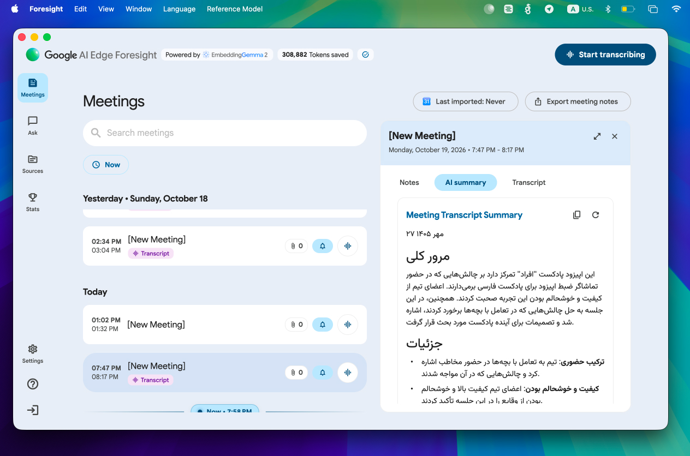

English interface — the AI summary still comes back in fluent Persian

</td>
<td width="50%">

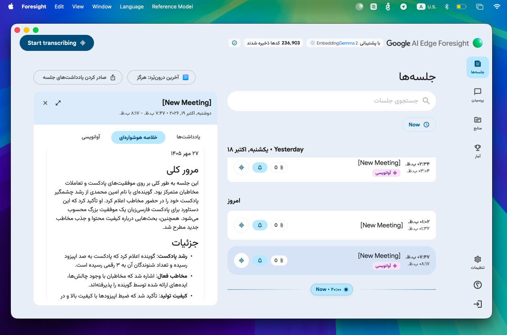

Persian interface, right-to-left — Farsight's default

</td>
</tr>
<tr>
<td width="50%">

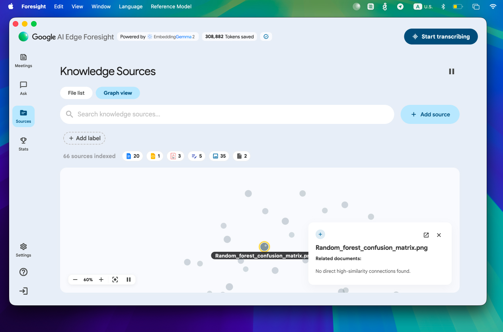

English interface

</td>
<td width="50%">

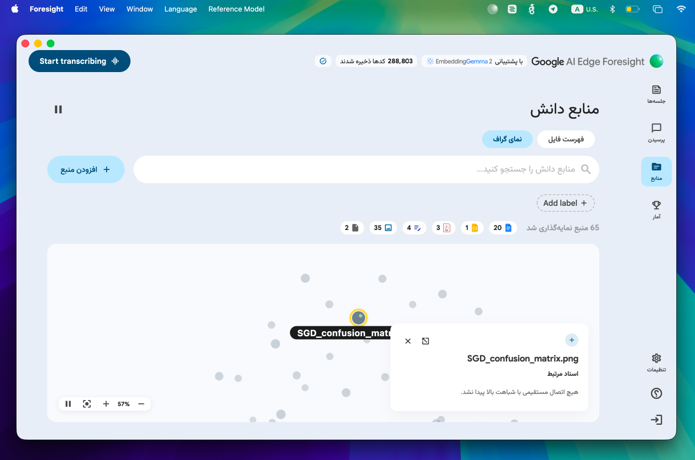

Persian interface

</td>
</tr>
<tr>
<td width="50%">

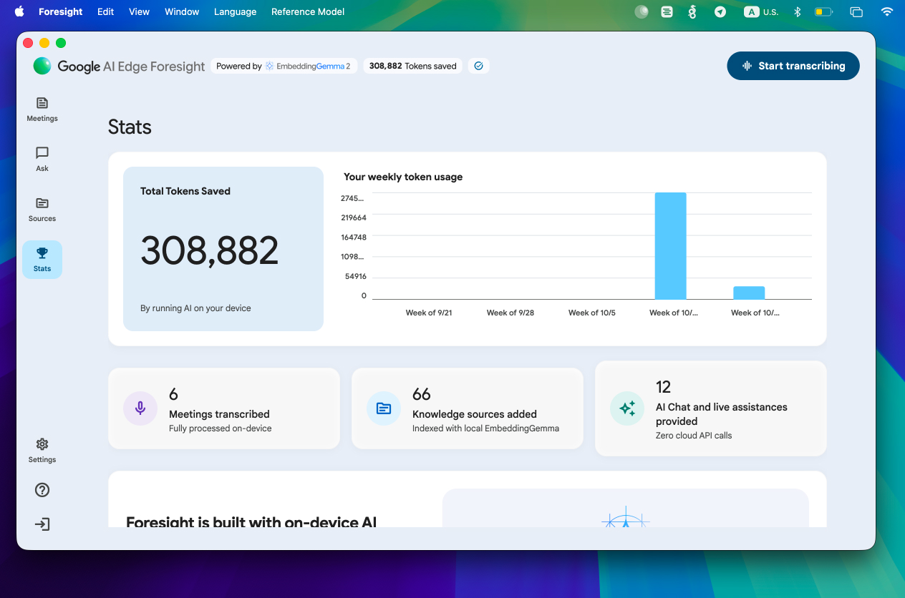

English interface

</td>
<td width="50%">

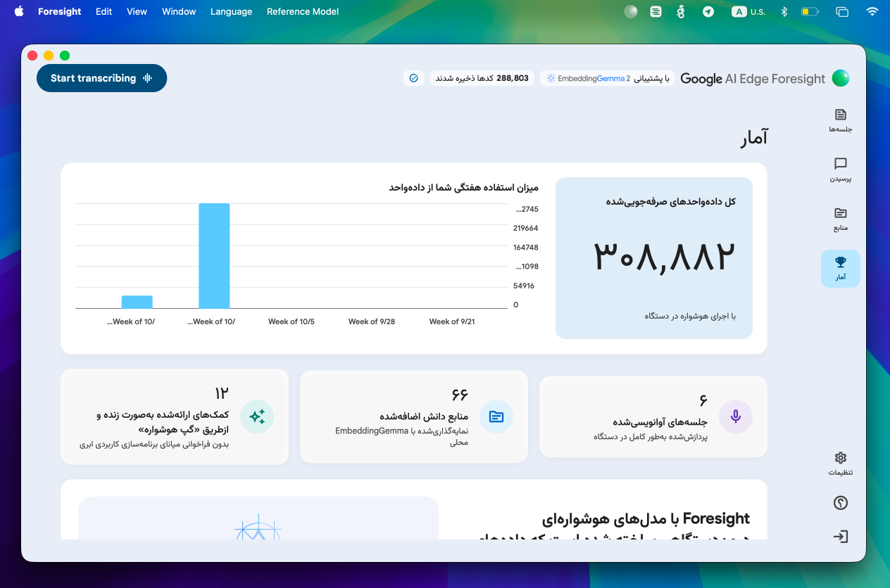

Persian interface — even the numbers switch to Persian digits

</td>
</tr>
</table>

## Requirements

- macOS on Apple Silicon
- Google AI Edge Foresight, opened once with its model downloads finished
- Xcode Command Line Tools (`xcode-select --install`)
- About 500 MB of disk space for the Persian engine (or ~150 MB with `FARSIGHT_MODEL=rizeh ./setup-persian.sh`, a smaller, less accurate model)

## Install

```bash
git clone https://github.com/hadi-buddy/farsight.git ~/tools/farsight
cd ~/tools/farsight
./setup-persian.sh     # sherpa-onnx + Shenava Koochik + Silero VAD → ~/Library/Application Support/farsight
shim/build.sh          # builds shim/libfarsight.dylib
./launch.sh            # restarts Foresight with Persian transcription
```

The repo must live at `~/tools/farsight`: the shim reads its settings from there.

Optional extras:

```bash
# Auto-relaunch: if Foresight starts without Farsight (Dock, login item, update), restart it with Farsight
./install-watcher.sh                 # remove with: ./install-watcher.sh --uninstall
```

For a Dock icon, pin **Foresight.app itself** (drag it from `/Applications` to the Dock, or right-click its icon while running → Options → Keep in Dock) rather than a separate launcher — with `install-watcher.sh` running, clicking it always ends up shimmed. A separate launcher app would show as its own Dock icon alongside Foresight's while running (two icons for one app); pinning Foresight directly keeps it to one, like any other app.

## Check that it works

```bash
grep -E "config:|asr" ~/Library/Logs/farsight/shim.log | tail
```

You should see `config: engine=persian` and `asr (persian): ready`. Start a recording and speak Persian; text appears phrase by phrase, after each pause.

To log every transcript for debugging: `FARSIGHT_TRACE=1 ./launch.sh`.

## Tuning

Copy `tuning.example` to `~/tools/farsight/tuning` and edit it: phrase pause, VAD sensitivity, audio padding around each phrase, CPU threads. Relaunch with `./launch.sh`; no rebuild needed. The values in use are logged as a `tuning:` line in `shim.log`.

With `dump = 1`, every phrase is saved as a WAV file plus its transcript in `~/Library/Logs/farsight/audio/` (`index.tsv`), which makes recognition errors easy to collect and compare.

## Limitations

- **Persian only.** English words inside Persian speech come out as Persian-script approximations. For an English meeting, open Foresight normally (without `launch.sh`).
- **UI language.** `launch.sh` opens Foresight in Persian (right-to-left). Use `FARSIGHT_LANG=en ./launch.sh` for English or `FARSIGHT_LANG=system` to follow macOS. A few labels, such as "Start transcribing", are not translated by Google (they're drawn by Foresight's own Flutter UI, which Farsight does not — and, as of investigating it, cannot safely — modify). Once Farsight is running, Foresight's own menu bar has a "Language" menu (next to Window) with فارسی/English — pick one and Foresight relaunches itself in that language, with no flash and no terminal needed. The choice also survives a full quit and a normal reopen (Dock, Spotlight, login item): it's written as a real on-disk preference under Foresight's own bundle ID, not just passed as a launch argument, since Foresight re-execs itself shortly after every cold start and loses its own argv in the process.
  <br>
- **Phrase by phrase.** Text arrives after each pause (about 0.6 s of silence), not word by word.
- **Foresight updates** can move what the shim relies on. If Persian text disappears after an update, check `shim.log`; without Farsight the app keeps working in English.

## Architecture

Foresight is a Flutter app. Its Dart code reaches Google's transcription library through a C API (`OdmlSpeechProcessorTranscribe`, `OdmlSpeechProcessorFinishStream`, …) resolved at runtime with `dlsym`. The app's entitlements allow `DYLD_INSERT_LIBRARIES`, so `launch.sh` starts it with `shim/libfarsight.dylib` loaded first.

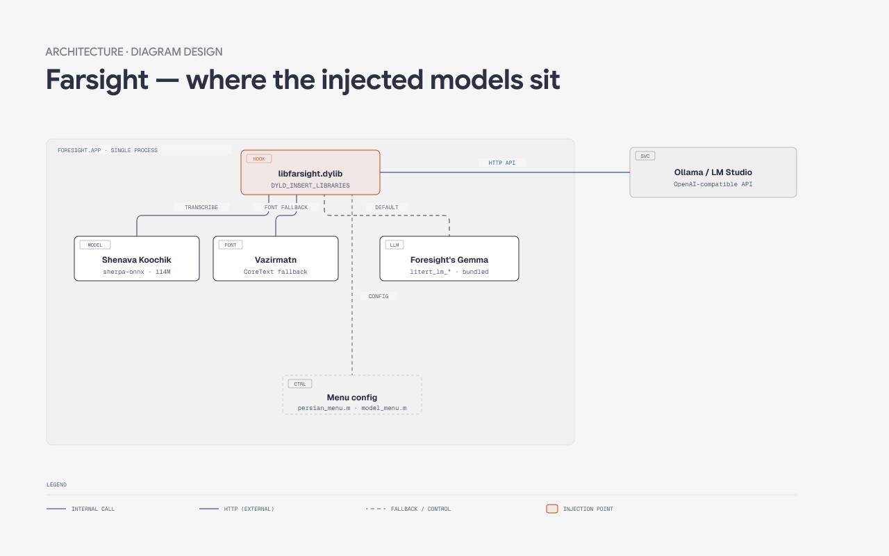

The shim never touches a *different* process to do its work, except for the optional chat/summary model — it swaps the function pointer each call site resolves to, inside Foresight's own process:

1. **Speech recognition is replaced.** The shim interposes `dlsym` and wraps the transcription calls. The audio Foresight hands over (48 kHz float, one stream for the microphone and one for system audio) is resampled to 16 kHz, cut into phrases with Silero VAD, and each phrase is transcribed by Shenava Koochik. Results go back in Foresight's own result format, so the app cannot tell the difference. See `shim/sensevoice_engine.c`.
2. **The ASCII filter is lifted.** Foresight's Dart layer deletes every character outside printable ASCII from transcripts, which would erase all Persian. The shim rewrites that regular expression in memory (copy-on-write; the file on disk is unchanged) so only control characters are removed.
3. **Persian text is cleaned up.** Shenava spells numbers out; `shim/persian_itn.c` turns well-formed spoken numbers into Persian digits (a lone «یک» stays a word, since it usually means "a"). `shim/persian_text.c` adds zero-width non-joiners («می‌شه», «طرح‌های») and fixes Arabic ي/ك. Each phrase is decoded with 0.35 s of audio before the detected start, so first syllables are not clipped. Tests: `shim/test/itn_test.sh`.

   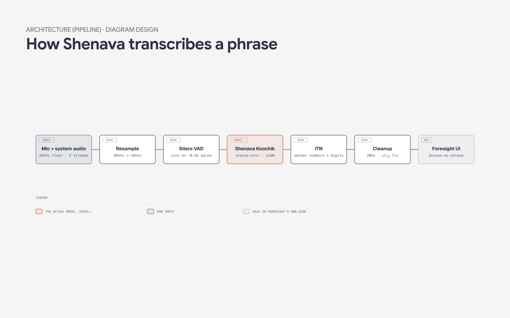

4. **Vazirmatn for Persian text.** Foresight's fonts have no Persian glyphs, so Flutter asks macOS (CoreText `CTFontCreateForString`) for a fallback font. The shim answers that call with Vazirmatn at the matching size and weight for Arabic-script runs. See `shim/persian_font.c`.

If the Persian model is missing or fails to load, the shim falls back to SenseVoice (if installed) and then to Foresight's own English engine.

## Chat and summaries on a local model

Foresight's chat and meeting summaries normally run on its built-in Gemma model, which answers in English. The shim can route them to any local OpenAI-compatible server (llama.cpp, LM Studio, Ollama's OpenAI endpoint, …).

Once Farsight is running, Foresight's own menu bar has a "Reference Model" menu (next to Language) — it auto-detects any of Ollama, LM Studio or a llama.cpp server running on their usual ports and lists their installed models, plus "Add…" for any other OpenAI-compatible server/model. Picking one relaunches Foresight on it, same as the Language menu; no terminal needed.

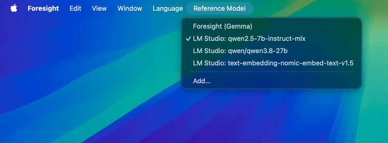

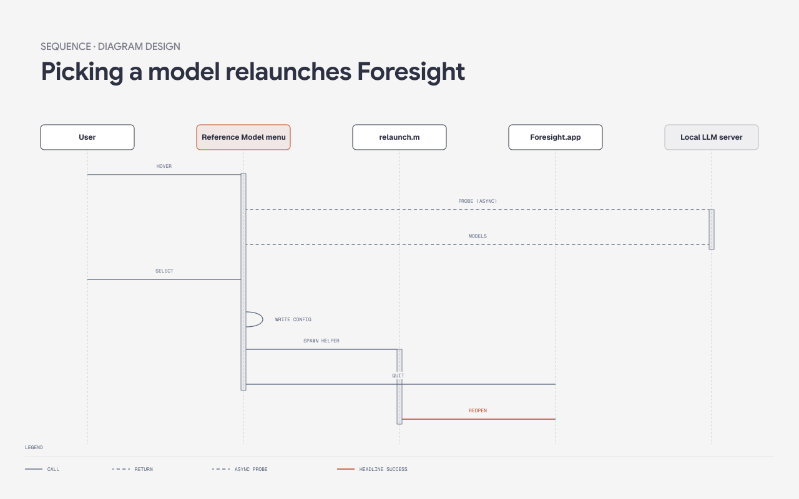

Under the hood, picking a model doesn't just update a setting — it writes the choice to disk and takes Foresight through a full quit-and-reopen, via a short-lived detached helper process (see `shim/relaunch.m`), so the new process reads the config fresh instead of racing the old one.

Foresight's built-in Gemma is small, and its Persian is serviceable but stiff; a larger local model reads noticeably more natural:

<table>
<tr>
<td width="50%">

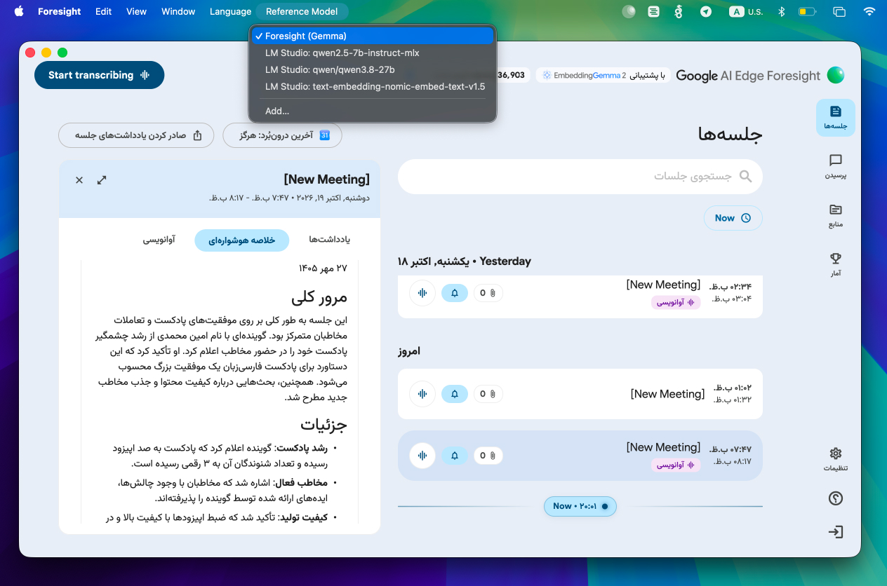

Default — Foresight's built-in Gemma

</td>
<td width="50%">

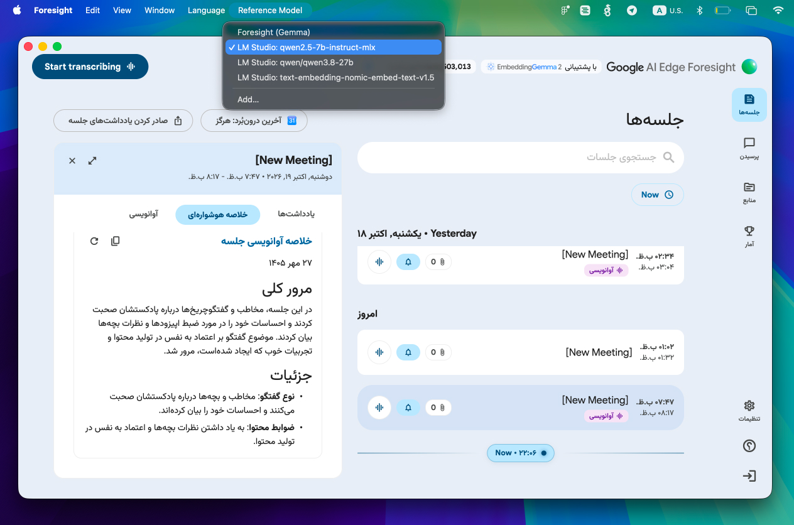

A local Qwen2.5-7B model, via LM Studio — more fluent Persian

</td>
</tr>
</table>

For a server on another port, or extra request fields the menu doesn't offer, put one line in `~/tools/farsight/chat` by hand instead:

```
<base_url> [model] [{extra JSON request fields}]
```

or `off` to disable it, then relaunch. When a transcript is mostly Persian, the bridge asks the model to write the summary in Persian while keeping Foresight's template headings. If the server is down, chat falls back to Gemma. See `shim/chat_bridge.c` and `shim/model_menu.m`.

## Files

| Path | Purpose |
| --- | --- |
| `shim/farsight.c` | `dlsym` interposition, transcription hooks, filter patch, engine selection |
| `shim/sensevoice_engine.c` | VAD + speech model via sherpa-onnx (Persian or SenseVoice) |
| `shim/persian_itn.c` | Spoken Persian numbers → digits |
| `shim/persian_text.c` | ZWNJ and Persian letter cleanup |
| `shim/persian_font.c` | Vazirmatn as the font for Persian text (CoreText fallback hook) |
| `shim/persian_date.c` | Today's date in the Jalali (Solar Hijri) calendar, prepended to Persian summaries |
| `shim/persian_menu.m` | "Language" menu in Foresight's own menu bar (فارسی/English, relaunches on change) |
| `shim/model_menu.m` | "Reference Model" menu: auto-detected local servers + "Add…", relaunches on change |
| `shim/relaunch.m` | Shared relaunch (quit, then open fresh) used by both menus |
| `shim/chat_bridge.c` | Optional chat/summaries on a local server |
| `setup-persian.sh` | Downloads the Persian engine |
| `launch.sh`, `watcher.sh`, `install-watcher.sh` | Launcher and auto-relaunch agent |
| `CHANGELOG.md` | What changed and why |

## Credits

- Built on [foresight-zh](https://github.com/michaelpersonal/foresight-zh) by michaelpersonal, which worked out the injection approach for Chinese.
- Persian speech models: [Shenava Koochik v1.0](https://huggingface.co/Reza2kn/Shenava-Koochik-v1.0-sherpa-onnx) and [Shenava Rizeh v1.0](https://huggingface.co/Reza2kn/Shenava-Rizeh-v1.0-sherpa-onnx) by [Reza2kn](https://github.com/Reza2kn) (Apache-2.0).
- Font: [Vazirmatn](https://github.com/rastikerdar/vazirmatn) by Saber Rastikerdar (SIL OFL 1.1).
- Inference: [sherpa-onnx](https://github.com/k2-fsa/sherpa-onnx) (Apache-2.0), [Silero VAD](https://github.com/snakers4/silero-vad) (MIT), [cJSON](https://github.com/DaveGamble/cJSON) (MIT).
- Architecture diagrams generated with [diagram-design](https://github.com/cathrynlavery/diagram-design) by Cathryn Lavery.
